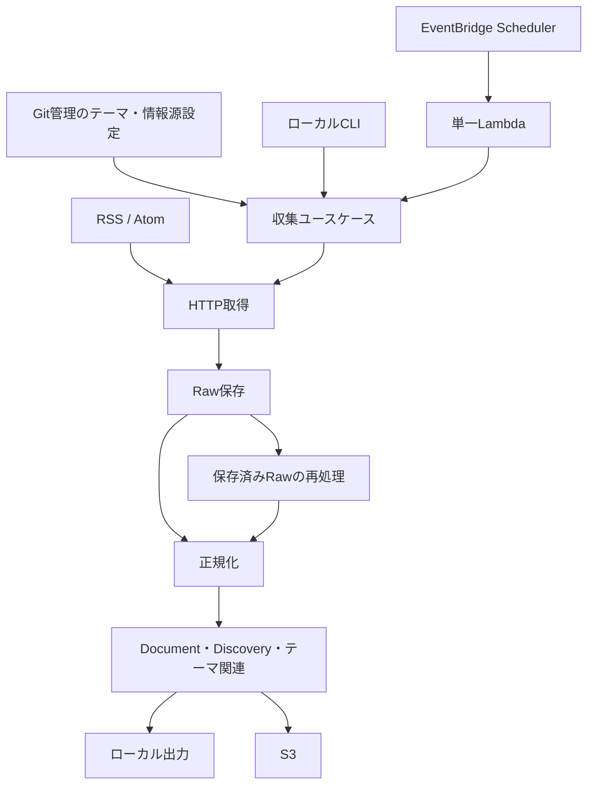

# アーキテクチャ方針

## 状態と目的

この文書はv1の設計方針を示す。アプリ・AWSリソースは未実装であり、データ契約の詳細は実装前に確定する。
curatedzは、関心テーマを起点として情報を収集し、後から検索・分析・行動に活用するための保存基盤である。

Topic-driven、Source-agnostic、Storage-first、Replayable、Idempotent、Composable、Cost-conscious、Observableを原則とする。
検索プロバイダーや通知処理を先に用意せず、v1の実処理に必要な境界だけを設ける。

## v1 の責務

- テーマと情報源を設定し、RSS / Atomから情報を取得する。
- 取得時点のRawと、正規化したDocument・発見履歴・テーマ関連を保存する。
- ローカルCLIとLambdaが同じ収集処理を使用する。
- 保存済みRawの再処理と、実行をまたぐ重複・内容更新に対応する。

Web Search、外部API追加、ページ本文抽出、LLM、通知、フィードバックフォーム、OpenSearchの構築・インデックス作成は対象外。

## 全体構成



AWSではRawもS3へ保存する。CLIは同じ論理レイアウトをローカルに出力できるようにする。
Schedulerは起動だけを担い、単一Lambda内で情報源ごとの取得・正規化・保存を実行する。
処理の分離はモジュール境界で行い、現時点ではStep Functionsや情報源別Lambdaへ分割しない。
Lambdaの実行時間・メモリの上限に収まるよう、情報源数、レスポンスサイズ、並列数、リトライを制限する。

## 技術選定

| 対象 | 比較と方針 |
| --- | --- |
| アプリ | Rustは型とID・正規化の契約を強く表現でき、CLIとLambdaで共有できる。Pythonは試作が容易、TypeScriptはIaCとの言語統一が利点。既存方針も踏まえてRustを第一候補とし、実装時にRSS解析・エンコーディング対応を確認して確定する |
| IaC | CDK TypeScriptはAWSリソースを型付きコードで表現できる。Terraformは別のツール体系、手書きCloudFormationは記述量が増えるため、CDKを第一候補とする |
| 設定 | YAMLは複数行の説明とテーマ・情報源の配列を読み書きしやすい。TOMLは型の曖昧さが少ないが入れ子の配列が冗長になる。YAMLを選び、型検証と未知フィールドの拒否で曖昧さを抑える |
| 保存 | Rawはバイト列を保持する。正規化データはJSONLをバッチ保存する。Documentごとの小さなJSONを大量に作る方式は避ける |
| 実行基盤 | Scheduler → Lambda → S3。複雑なメタデータDBや常時稼働コンポーネントは導入しない |

具体的なライブラリ、ランタイム、CDKのバージョンとロックファイルは実装時に追加する。
現在のmiseにあるNode・Codex等は開発ツール用の既存固定値であり、アプリのランタイム選定ではない。

## 設定

設定はGit上のYAMLを正とし、検証済み設定をデプロイ成果物に含める。
テーマと情報源を別のIDで定義し、テーマから情報源IDを参照する。共有情報源は一実行で一度取得する。
YAMLの構文だけでなく、型・ID重複・参照整合性・未知フィールドを検証する。
SSM経由の設定取得は必須としない。秘密情報が必要になった場合はAWSではSecrets Manager、ローカルでは環境変数などから注入する。

## ディレクトリ

現在存在する開発基盤:

```text
AGENTS.md                   開発指針
.codex/                     Codex設定・ルール・開発支援skill
.github/                    CI・PRテンプレート・検証スクリプト
.vscode/                    編集設定・推奨拡張
README.md                   状態・入口
mise.toml                   開発ツール・検証コマンド
docs/                       設計・開発・運用・実装計画
```

実装時に追加する候補:

```text
config/                     テーマ・情報源設定と例
crates/core/                モデル・ID・正規化・ユースケース
crates/cli/                 ローカル実行
crates/collector-lambda/    Lambdaエントリーポイント
infra/                      CDKアプリと必要なconstruct
fixtures/                   RSS / Atom等のテストデータ
```

空ディレクトリや未実装コマンドは、この段階では追加しない。

## データと保存

Document・Discovery・Topic associationを分離する。[データモデル案](data-model.md) を参照。
S3は正本、ローカルファイル出力は開発・テスト用の同じ保存契約とする。
Raw保存後に解析し、解析に失敗したRawも再処理できるようにする。

冪等性は「HTTPを再取得しない」「記事を再保存しない」「発見履歴を失わない」を混同しない。
実行・再処理ID、Document ID、内容ハッシュ、完了manifestを組み合わせ、保存中断と再実行の境界を設計する。

## 失敗・観測・費用

情報源単位の失敗を記録して他を継続する。保存失敗を隠さず、成功・部分成功・全件失敗を実行結果に残す。
構造化ログにrun_id、source_id、stage、収集数、更新数、重複数、失敗数、所要時間を含める。
HTTPはタイムアウト、有限のバックオフ、取得サイズ・並列数の上限を持つ。
S3リクエスト数と索引の読み書き量、Lambda実行時間、ログ保持期間を費用の評価対象にする。

## 未解決事項とトレードオフ

- JSONLのバッチ保存と実行をまたぐ重複排除の両立。S3索引・スナップショット案の読み書き量と中断復旧を検証する。
- 単一writerの保証方法。Lambdaの同時実行制限だけではローカルCLIとの競合を防げない。S3への同時書き込みを制御する方法を決める。
- URL正規化規則、URLがない記事、異なる情報源のメタデータ競合と内容ハッシュの対象。
- manifest公開と索引更新の順序、公開済みバッチを二重処理しない取り込み契約。
- 設定変更時のテーマ関連削除・履歴の扱い、再処理時の設定・正規化バージョンの保持。
- スケジュール周期、取得上限、Raw保持期間、ログ保持期間、監視閾値。

実装前に判断を記録し、日付を変えた再実行と保存途中の障害をテストする。

## 将来の拡張

自宅Talos / Kubernetes上のOpenSearchがS3からPullし、Document IDでupsertする。
差分取り込みは完了manifestを境界とし、再インデックスは保存済みデータから行う想定。
Web Search追加時は規約に基づく保存範囲を確認し、検索結果メタデータとページ本文を分離する。
Enriched、LLM、通知は保存データを入力とする別処理として追加する。
