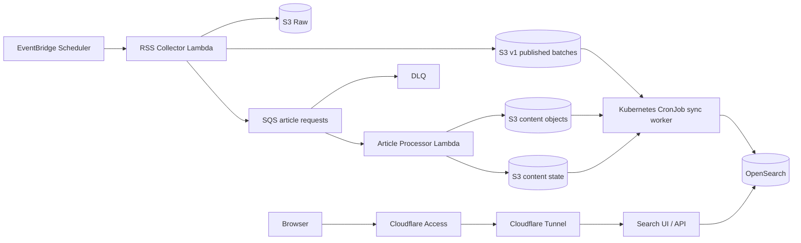

# v2 設計

## 目的と判断の前提

v2 は、v1 の RSS/Atom 収集と S3 の公開済みバッチを土台に、記事本文の取得、自宅 Kubernetes への差分同期、検索 API/UI を追加する。
S3 を唯一の Source of Truth とし、OpenSearch はいつでも再構築できる派生インデックスとして扱う。

この文書は実装前に定めたデータ契約、失敗時の扱い、Phase 間の依存関係と、その実装状況を記録する。未適用の項目は明記し、実環境の機能として扱わない。

## 現状整理

v1 は Rust の共通 crate を CLI と単一 Lambda から利用し、TypeScript CDK で S3、Scheduler、Lambda、DLQ、監視を定義している。
RSS/Atom の元バイト列を `raw/v1/` に保存し、Document・Discovery・Association を不変 JSON Lines バッチへ分離する。
`state/v1/head.json` の条件付き更新が公開境界であり、公開された manifest だけを generation 順に読むことで、未公開バッチや競合中のデータを除外できる。

v1 には既に次の性質がある。

- fragment の除去、既定 port と host の URL ライブラリによる正規化、query の保持
- canonical URL、または URL がない場合の source ID と source item ID による決定的な Document ID
- 同一 Document の更新と、発見履歴・テーマ関連の分離
- Raw replay、同一 run の再開、head の CAS 競合時の再計画
- 認証情報なしで動く fixture、ローカル Store、S3 アダプターのテスト

v2 の本文取得要求、本文保存、SQS Processor、同期 worker、OpenSearch、自宅 Kubernetes、検索 API/UI は実装済みである。AWSと自宅Kubernetesへデプロイし、CronJobによるS3からOpenSearchへの差分同期、Cloudflare Tunnel / Access配下のUI/APIからの検索を実環境で確認済みである。

## 採用アーキテクチャ



AWS から自宅環境への接続は作らない。同期 worker が S3 を Pull する。
Collector と Processor は分け、フィードの部分失敗と本文サイトの失敗を互いに波及させない。
本文抽出の再試行やバージョン更新は、RSS を再取得せずに行えるようにする。

自宅同期のAWS principalはCDKでIAM Roles Anywhere用の`Curatedz-HomeSync` Roleとして作成し、同期対象prefixだけを読み取れるManaged Policyとpermissions boundaryを関連付ける。外部CAの公開証明書をTrust Anchorへ登録し、`CN=curatedz-home-sync`のend-entity証明書だけがProfile経由でRoleを引き受けられるよう、trust anchor ARN、AWS account、証明書CNを信頼条件にする。Podは`aws_signing_helper`の`credential_process`から有効期間1時間のSTS認証情報を取得し、IAM Userと長期Access Keyは作成しない。CA秘密鍵とworkload秘密鍵はCDK、GitHub Actions、CloudFormation Output、Gitに渡さない。

## データ契約

### 既存レコードとの関係

v1 の Document・Discovery・Association と `state/v1/head.json` は互換性を保つ。
本文取得のために v1 Document の同一性や `content_hash` の意味を変更しない。
要求にある単一の「記事データ」表示は、同期 worker が以下を article ID で結合して OpenSearch 文書へ投影する。

| 要求フィールド | 正規データ |
| --- | --- |
| `schema_version` | 各レコードの schema version。OpenSearch 投影にも独立して持つ |
| `article_id` | v1 の `document_id`。移行時に ID を振り直さない |
| `source_type` | v2 では `rss` 固定。将来の型を先行実装しない |
| `source_id`, `feed_url` | Discovery と Git 管理の検証済み設定 |
| `original_url` | feed entry の URL。Phase 1 で Discovery に追加する |
| `canonical_url` | Document |
| `title`, `description`, `published_at` | Document |
| `first_seen_at`, `last_seen_at` | 公開済み Discovery から同期時に集約 |
| `content.*`, `processing.*` | v2 Content record |

複数 feed で同じ Document が見つかった場合、Document は一つのまま、Discovery は source ごと・run ごとに残す。
異なる canonical URL が実際に同じ記事かどうかは一般には決定できないため、自動統合しない。
HTTP redirect や HTML の canonical link を採用して別 ID へ付け替える処理も初期 v2 では行わず、観測値として Content record に残す。

### Content record（実装済み）

本文の current record は次の論理フィールドを持つ。

```json
{
  "schema_version": 1,
  "article_id": "sha256:...",
  "requested_url": "https://example.com/a",
  "final_url": "https://example.com/a",
  "declared_canonical_url": null,
  "text_key": "content/v1/blobs/sha256....txt",
  "text_hash": "sha256:...",
  "status": "succeeded",
  "fetched_at": "2026-01-01T00:00:00Z",
  "http_status": 200,
  "content_type": "text/html",
  "failure": null,
  "processing_version": "1",
  "attempt": 1
}
```

`status` は `succeeded | fetch_failed | extraction_failed | skipped` とする。
失敗情報は分類可能な短い code と、秘密や本文を含まない message を持つ。
本文テキストは content-addressed な不変 blob、record は processor の条件付き更新で公開する。
成功済みの同一 `processing_version` と URL は再取得しない。版を上げた明示的な再処理では既存 Raw HTML を利用できる設計を優先する。

HTML の永続保存は著作権、容量、再処理性のトレードオフがある。初期実装ではレスポンス上限以下の Raw HTML を非公開 S3 に保存し、ライフサイクル日数は運用者が決めるまで自動削除しない。公開検索結果には抽出本文と元記事リンクだけを使う。

### S3 レイアウト

```text
batches/v1/<transaction_hash>/article_requests.jsonl
article-content/v1/raw/article=<article_id>/response=<hash>.bin
article-content/v1/blobs/<text_hash>.txt
article-content/v1/records/article=<article_id>/version=<processing_version>/<record_hash>.json
article-content/v1/commits/generation=<zero-padded-generation>-<commit_hash>.json
article-content/v1/state/head.json
```

Phase 1 で、Collector は既存 head の公開対象 batch に request JSONL を不変保存し、head 公開後に SQS へ送る。
S3 保存と SQS 送信は原子的ではないため、request JSONL を送信元の正とし、未送信・送信結果を監査して再送できる CLI を用意する。
SQS メッセージ本文には bucket/key、article ID、URL、processing version だけを含め、本文や秘密を含めない。

Processor は Raw、本文、record、content commit を不変保存し、最後にcontent headを条件付き更新して公開する。headはarticle IDごとのcurrent recordとgenerationごとのcommit参照を同じCAS境界で保持する。
同期 worker は RSS head と content head の generation/checkpoint を別々に保持し、bucket 全体を走査しない。
generation commit は変更された article ID と record key のみを列挙する。

## URL と記事 ID

v1 の互換規則を維持する。

- `http` / `https` だけを許可し、userinfo を拒否する。
- host を URL ライブラリで正規化し、fragment と既定 port を除く。
- query parameter は追跡用途か本文同一性に必要かを安全に判別できないため保持する。
- `http` と `https`、末尾 slash、異なる path、異なる query は同一視しない。
- feed の URL がない場合だけ source ID と source item ID を ID 入力にする。

本文取得後の final URL と HTML canonical は観測情報であり、既存 article ID を変更しない。
将来、明示的な alias record を追加して検索時に統合できるが、初期 v2 の対象外とする。

## Article Processor の安全性と失敗

### SSRF と HTTP 制約

- URL の scheme、userinfo、port を検証し、許可 port は原則 80/443 とする。
- DNS 解決した全 address について loopback、private、link-local、multicast、unspecified、CGNAT、各クラウド metadata address を拒否する。
- redirect は最大 5 回とし、各遷移で URL と再解決した address を再検証する。
- DNS rebinding 対策として、接続先を検証済み address に固定できる HTTP adapter を用いる。
- connect/read/全体 timeout、最大 response bytes、圧縮展開後上限、有限 retry と指数 backoff を設ける。
- HTML/XHTML 以外を本文抽出対象にしない。
- User-Agent と連絡先を明示し、site 単位の同時実行数と最小間隔を制限する。
- robots.txt の取得・判定結果を TTL 付きで利用し、禁止時は `skipped` とする。利用条件上の禁止は設定で source を無効化する。

ネットワーク判定、HTTP、抽出器、Store は小さな adapter に分け、DNS/AWS/外部サイトなしでテストする。
JavaScript レンダリング、ログイン、paywall 回避は実装しない。

### SQS と冪等性

SQS Standard Queue の少なくとも一回配信を前提にする。
Lambda event source mapping は部分バッチ応答を有効にし、失敗メッセージだけを再試行する。
visibility timeout は Lambda timeout の 6 倍以上、redrive 後の DLQ 保持は 14 日とする。
Processorのスケール上限はSQS event source mappingの`MaximumConcurrency=2`で制限する。関数のreserved concurrencyは、アカウントの未予約同時実行枠を最低10残すAWS制約と小さいquotaが衝突するため使用しない。site単位の間隔制御とS3 CASによる競合解決は、複数invocationでも成立させる。

各メッセージで current state を読み、同一入力・同一 processor version の成功済み record があれば成功として終了する。
競合更新に敗れた処理は winner を再読込し、同等以上なら成功、そうでなければ有限回だけ再計画する。
取得失敗でも RSS metadata は既存バッチに残る。恒久エラーと retryable error を区別し、後者だけ Lambda を失敗させる。

## OpenSearch 同期と再構築

同期 worker は Rust で実装し、共通の S3/OpenSearch adapter を CLI と CronJob から利用する。
checkpoint は Kubernetes Secret ではなく、専用 S3 prefix または永続 volume に条件付き保存する。単一 CronJob は `concurrencyPolicy: Forbid` とし、重複起動時も generation と article ID によって冪等にする。

同期用証明書と秘密鍵はGit外のKubernetes Secretへ格納する。workload証明書の更新時は新しい証明書を反映して同期成功を確認してから旧証明書を失効させる。秘密鍵の漏えい時は証明書を失効し、Trust AnchorにCRLを関連付けるかCAを交換する。CA秘密鍵はクラスタへ配布しない。

OpenSearch の `_id` は article ID とし、Bulk API の index/upsert を利用する。
RSS と Content の checkpoint は Bulk 応答で全 item が成功した後だけ進め、部分失敗 item のみ再試行する。
再構築は新しい versioned index を作り、S3 の公開済み generation を 0 から投入し、件数と失敗を確認後に alias を原子的に切り替える。

初期 mapping は title/description/content に日本語・英語の全文検索、published/first/last seen に date、source IDs に keyword を使用する。
日本語 analyzer/plugin の利用可否と形態素辞書の運用負荷を実機検証し、利用できない場合は ICU/ngram の小さい構成を選ぶ。
OpenSearch のバージョン、chart、storage class、容量、backup 方針は自宅 cluster の既存 GitOps 方針を確認して固定する。

## Search API/UI と境界防御

Search API は OpenSearch DSL を外部へ露出せず、query、日付範囲、topic ID、既読状態、page/size に限定する。queryを省略した場合は新着記事一覧として公開日時、最終発見日時、article IDの順に決定的に並べ、queryがある場合は全文検索の関連度を優先する。
結果はarticle ID、title、抜粋、公開日時、topic、情報源、既読日時、元記事URLを返し、保存HTMLを配信しない。
UI は同じ origin で API を利用するレスポンシブ Web UI とし、初期表示で新着記事を取得する。iPhone の狭い画面でも filter と結果を一列で操作できるようにする。

### topicフィルタと既読状態

Readerの絞り込みは情報源IDの自由入力ではなく、実運用設定にあるtopicを選択する。同期workerは公開済みmanifestのAssociationを読み、記事ドキュメントの`topic_ids`へ重複なく追加する。過去のAssociationを削除しない既存契約に合わせ、設定からtopicやsourceの関連を外しても過去記事の`topic_ids`は自動削除しない。topicを再分類する場合は、新設定でAssociationを生成した後、source IDと新設定の対応からOpenSearchの派生indexを再投影する。generation 0からのrebuildだけでは過去のAssociationも再適用されるため、旧topic IDの除去にはならない。

Webの`GET /api/topics`は、公開例の設定を埋め込まず、OpenSearchの記事indexに実在する`topic_ids`をterms aggregationで列挙する。既知のtopic IDは安定した表示名へ変換し、未知のIDはID自体を表示名として返す。検索APIの`topic`は`topic_ids`の完全一致filterへ変換する。これにより、非公開の実運用設定とReaderの選択肢が乖離せず、記事がまだ存在しないtopicは空の選択肢として表示されない。

既読状態は個人利用の単一ユーザー状態として扱う。記事ドキュメントの`read_at`を検索用の投影とし、`PUT /api/articles/{article_id}/read`で既読、`DELETE /api/articles/{article_id}/read`で未読へ戻す。検索APIは`read=all|unread|read`を受け付け、既定値を`unread`とする。記事リンクを開いた操作も既読更新を行うが、更新失敗時に元記事の閲覧を妨げない。

既読状態の正は記事とは別の`curatedz-reader-state` indexにarticle IDごとのrecordとして保存する。既読化は状態recordを先にupsertしてから記事投影を更新し、未読化は状態recordを削除してから記事投影を更新する。途中失敗はHTTP 502として返し、同じ操作の再試行を安全にする。記事indexのrebuildではalias切り替え前に状態indexを走査して`read_at`を新indexへ復元する。OpenSearch全体を失う場合に備えた状態indexのbackupは運用上の残課題とする。

Cloudflare Tunnel の ingress は UI/API Service だけを向け、OpenSearch Service は ClusterIP と NetworkPolicy で API Pod からだけ許可する。
Cloudflare Access policy は人間が Zero Trust 上で作成し、repository に許可メールアドレスや token を固定しない。
API は `Cf-Access-Jwt-Assertion` の署名、issuer、audience、expiry を検証し、Tunnel/Access を迂回した未認証 request も拒否する。
Tunnel credential、Cloudflare API token、AWS credential は Secret 管理し Git に保存しない。

### 読み取り専用管理画面

運用状態はReaderへ混在させず、同じWeb Serviceの`/admin`と`/api/admin/status`へ分離する。両方にReaderと同じCloudflare Access JWT検証を適用する。初期実装はWebが既に読み取れるOpenSearch情報だけを対象とし、WebへKubernetes API、AWS、S3の権限を追加しない。

管理APIは次のJSON契約を返す。

```json
{
  "generated_at": "2026-11-22T00:00:00Z",
  "search": {
    "status": "green",
    "number_of_nodes": 1,
    "active_primary_shards": 2,
    "unassigned_shards": 0
  },
  "articles": {
    "total": 10,
    "latest_published_at": "2026-11-21T12:00:00.000Z",
    "latest_seen_at": "2026-11-21T13:00:00.000Z"
  }
}
```

`latest_published_at`と`latest_seen_at`は該当値がない場合`null`とする。OpenSearchのcluster healthまたは記事集計の取得・デシリアライズが失敗した場合、推測値や直前値を正常値として返さず、API全体をHTTP 502にする。ブラウザへ内部URL、OpenSearch応答本文、query、認証情報を返さず、画面は取得不能として表示する。

この画面は監視状態の閲覧専用である。同期開始、再構築、index削除、Secret操作などの変更操作は含めない。AWS側の収集成功時刻、S3 generation、情報源別失敗は現在のWeb権限だけでは確実に取得できないため、表示済みと扱わず、将来の明示的な運用状態契約として別に設計する。

## 可観測性

構造化ログには `run_id` または `message_id`、`article_id`、`source_id`、`stage`、処理版、所要時間、結果 code を含める。
URL、HTML、本文、認証情報、query に秘密を含む可能性がある値はログへ出さない。

AWS では Collector の既存指標に加え、request 数、Processor 成功/失敗/skip、DLQ visible messages、S3 commit 数と最終成功時刻を監視する。
自宅側では sync generation lag、Bulk item 成功/失敗、最終同期時刻、index document 数、API error/latency を監視する。
通知先の追加は運用者の選択と費用確認後に行う。

## テスト戦略

- Phase 1: URL 正規化、ID、同一/複数 feed、日またぎ、更新、request 再送、CAS 競合
- Phase 2: public/private/再解決 address、redirect、timeout、展開後サイズ、robots、抽出 fixture、SQS 重複、部分バッチ失敗
- Phase 3: fake S3/OpenSearch による checkpoint、Association投影、Bulk 部分失敗、upsert、0 からの rebuild、既読復元、mapping 構成テスト
- Phase 4: query/topic/既読filter validation、既読更新、JWT の正当/期限切れ/issuer・audience 不一致、未認証拒否、NetworkPolicy/ingress 構成テスト、mobile viewport

単体・構成テストは AWS、Cloudflare、外部 feed/site、本番 Kubernetes を必須にしない。
実環境テストは別手順とし、明示承認なしに deploy や DNS/Access policy の変更をしない。

## 実装計画と依存関係

### Phase 1: 永続化契約の拡張（実装済み）

1. [x] Discovery に original URL を後方互換な optional field として追加する。
2. [x] article request schema、不変 request object、再送可能な outbox 相当の契約を追加する。
3. [x] Collector が head 公開後に新規/更新候補を enqueue する処理を追加する。同じrunの再実行を再送経路とする。
4. [x] SQS/S3 IAM、queue/DLQ/alarms を CDK に追加する。
5. [x] 既存 fixture と競合テストを維持し、追加契約を docs に反映する。

Phase 1 完了条件は、RSS metadata が従来どおり公開され、同じ run の再実行や SQS 重複でも要求が欠落・増殖せず、本文処理失敗の影響を受けないこと。

### Phase 2: 本文取得（実装済み）

1. [x] core に URL 安全性、fetch、extract、content state の domain と adapter を追加する。
2. [x] fixture ベースの本文抽出と SSRF/上限テストを先に実装する。
3. [x] Processor Lambda と SQS 部分バッチ応答を実装する。
4. [x] S3 prefix/IAM、event source、DLQ/監視を CDK に追加する。
5. [x] 公開済みRSS manifestとcontent headから未処理記事を復元するbackfill/再処理CLIと運用手順を追加する。

Phase 2 は Phase 1 の request/content 契約に依存する。

### Phase 3: 自宅検索基盤（実環境適用済み）

1. [x] 自宅 Kubernetes/GitOps repositoryを確認し、Longhorn、Argo CD native OCI、手動sync、Git外Secretという既存方針を採用する。
2. [x] OpenSearch 3.9.0 の最小単一node構成とLonghorn PVC、health probe、resource limitを定義する。
3. [x] sync workerとcheckpoint、Bulk、別indexからaliasを切り替えるrebuild CLIを実装する。
4. [x] OpenSearchをWeb/sync Podからだけ許可するNetworkPolicy、15分CronJob、復旧手順を追加する。

Phase 3 は Phase 2 の content commit 契約に依存する。Kubernetes manifest は既存方針に従い、`infra/home-k8s-app/curatedz` に配置した。実clusterへ適用し、CronJobによるS3の差分取得、OpenSearchへの投入、検索UIでの表示を確認済みである。

### Phase 4: UI/API と Cloudflare（実環境適用済み）

1. [x] query、日付、source、page/sizeに限定したAPI契約とAccess JWTの署名・issuer・audience・expiry検証を実装する。
2. [x] responsive UIとUI/API未認証拒否テストを実装する。
3. [x] Tunnel Deployment、Git外Secret参照、手動作成するAccess Application/Policyの手順を既存GitOps repositoryへ追加する。
4. [x] Cloudflare Tunnel/Application/許可メールPolicyを作成し、Cloudflare Access配下のUI/APIから検索できることを実環境で確認する。

Phase 4 は Phase 3 の mapping/API 接続契約に依存する。

## コスト見積もりの考え方

追加 AWS コストは SQS request、Processor Lambda 実行、S3 GET/PUT/保存量、CloudWatch logs/metrics、S3 から自宅への internet data transfer で決まる。
無料枠や単価はリージョン・時期で変わるため、deploy 前に対象 account/region の現行価格で、1 日の feed 記事数、平均 HTML/本文 byte、再試行率、同期頻度を入力して月額を再計算する。
OpenSearch と API/UI は自宅資源を使うが、永続 volume、電力、バックアップ容量、Cloudflare plan の条件を別途確認する。

コストを抑えるため、本文 request は新規または明示再処理だけに限定し、S3 差分 commit を使い、CronJob でまとめて Bulk 投入する。VPC/NAT、Step Functions、DynamoDB、AWS OpenSearch Service、常時稼働 AWS server は追加しない。

### 初期運用の概算

東京region、100記事/日、平均Raw HTML 500 KiB、抽出本文50 KiB、Processor 1 GiB・平均1秒、再試行10%、自宅同期15分を仮定する。月あたり本文保存増分は約1.65 GiB、Processorは約3,300 invocation・3,300 GB秒、SQSはsend/receive/deleteを含めても概ね1万request未満となる。公開価格の目安（Lambda $0.20/100万requestと約$0.0000167/GB秒、SQS 100万request/月のfree tier、S3 Standard $0.0265/GB月の例）では、free tierを無視しても本文処理computeと当月増分storageはそれぞれ約$0.06、$0.05である。S3 request、CloudWatch logs/alarm、自宅向けdata transfer、税を含めた初期目安は月$1未満だが、Rawを無期限保持すると1年で約20 GiB（同単価例で約$0.53/月）ずつ累積する。

これは請求額の保証ではない。deploy前に実際の東京region単価、既存free tier消費、平均response byte、CloudWatch alarm数、internet data transferをAWS Pricing Calculatorで更新する。[S3](https://aws.amazon.com/s3/pricing/)、[Lambda](https://aws.amazon.com/lambda/pricing/)、[SQS](https://aws.amazon.com/sqs/pricing/)の公式価格ページを根拠とし、価格改定時はこの概算を更新する。

## Assumptions / Open Questions

- AWS region と実運用の記事件数・平均本文サイズが未提示であり、金額の確定見積もりは deploy 前に行う。
- robots.txt は Processor のメモリに1時間キャッシュする。Raw HTML の保持期間と本文の個人利用上の保持可否は、運用者が初回デプロイ前に決める必要がある。
- 本文抽出には `readabilityrs` を採用し、fixture と Lambda ARM64 build で検証した。実サイトでの抽出品質確認は未実施である。
- 自宅Kubernetesは`infra/home-k8s-app`のArgo CD native OCI、Longhornを使用し、実clusterへ適用済みである。構成変更のsyncは引き続き人間の明示操作とする。
- Cloudflareのzone/account、許可identity、TunnelはZero Trustで作成済みであり、team domain、AUD、Tunnel tokenはGit外Secretとして管理する。
- 購読記事の認証・取り込みは v2 対象外であり、cookie や credential を Processor へ渡さない。

主要経路は実環境で稼働済みである。残る判断事項はRaw HTMLの保持期間、本文抽出品質、監視通知、容量・費用、バックアップと復旧訓練などの運用品質に関するものである。
